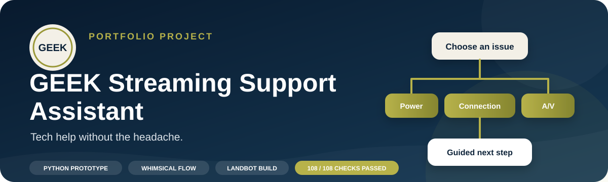
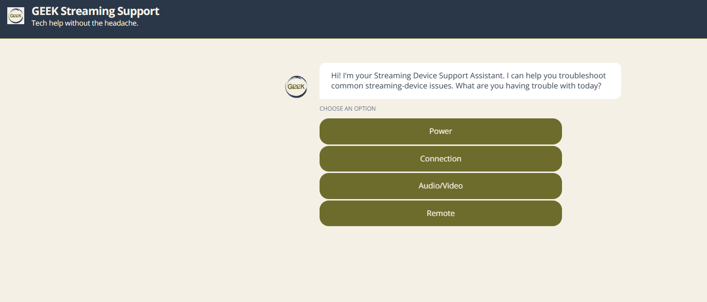
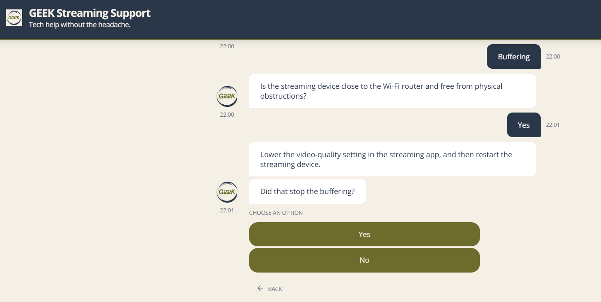
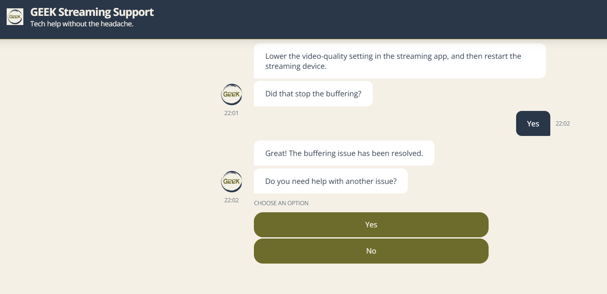

  

  
  
  
  

  <a href="#live-demo">Live Demo</a> •
  <a href="#project-snapshot">Project Snapshot</a> •
  <a href="#development-process">Development Process</a> •
  <a href="#testing-results">Testing Results</a> •
  <a href="#selected-visual-evidence">Visual Evidence</a> •
  <a href="#repository-contents">Project Files</a>

# GEEK Streaming Support Assistant

## Live demo

  

A guided troubleshooting assistant for common streaming-device problems, built as a portfolio proof of concept.

I designed the logic by hand, prototyped it in Python, mapped it in Whimsical, and rebuilt it as a branded no-code experience in Landbot. The project shows how a simple interface can guide users through a larger decision tree while keeping the experience clear and manageable.

## Project snapshot

| | |
|---|---|
| **Role** | Conversation design, Python prototyping, no-code development, testing, and documentation |
| **Tools** | Python, Google Colab, Whimsical, Landbot, and Google Sheets |
| **Scope** | 4 support categories, 8 symptom routes, and 32 valid Python paths |
| **Validation** | 108 of 108 planned checks passed after fixes and retesting |
| **Status** | Published and fully validated proof of concept |
| **Live experience** | [Launch the published assistant](https://landbot.site/v3/H-3506403-G3DA4GXEUHU8HWRC/index.html) |

## The problem

Streaming-device support pages can overwhelm users with long lists of possible fixes. Someone with a blank screen may not know whether the problem is the TV input, HDMI connection, cable, or streaming device.

I wanted to create a calmer support experience that narrows the problem one decision at a time, recommends a relevant first-line action, and checks whether the issue was resolved.

## How it works

1. The user selects **Power**, **Connection**, **Audio/Video**, or **Remote**.
2. The assistant narrows the category to one of two symptoms.
3. A diagnostic question determines which troubleshooting step appears.
4. The user confirms whether the step worked.
5. Resolved issues receive a success message and an option to get more help.
6. Unresolved issues move to a support-request form.
7. After submission, the user receives a personalized confirmation.

## Development process

### 1. Hand-mapped planning

I started by writing the conversation paths in a physical notebook. Planning before building helped me see how each choice should connect and made it easier to catch gaps early.

### 2. Python prototype

I used Python `if`/`elif`/`else` logic in Google Colab to create the first working decision tree. The prototype includes four categories, eight symptoms, diagnostic questions, troubleshooting actions, success outcomes, escalation concepts, and invalid-input handling.

### 3. Visual flowcharts

I translated the Python logic into flowcharts so I could review the branches, labels, connectors, and endpoints visually.

### 4. Landbot build

I rebuilt the core logic in Landbot and added buttons, reusable navigation, branding, form collection, email validation, saved fields, and personalized confirmation.

## Testing results

| Test area | Planned checks | Final result |
|---|---:|---:|
| Python logic | 40 | 40 passed |
| Flowchart validation | 28 | 28 passed |
| Landbot UAT | 40 | 40 passed |
| **Total** | **108** | **108 passed** |

The first Python test run produced 37 passes and 3 failures. Those failures revealed two defects:

- Extra spaces and capitalization were not normalized consistently.
- An invalid yes/no response such as “maybe” could follow the wrong path.

I corrected both issues with `.strip()`, `.lower()`, and a reusable validation loop, then reran the failed cases. All three retests passed, and no defects remain open.

## Selected visual evidence

### Main menu

### Troubleshooting step

### Successful resolution

The remaining screenshots document return navigation, the support form, validation behavior, and the personalized confirmation and closing experience.

## Repository contents

| Project evidence | Link |
|---|---|
| Python prototype | [Open notebook](python/StreamingChatBotAI-Project.ipynb) |
| Portfolio case study | [Read case study](docs/CASE_STUDY.md) |
| Project overview | [Read overview](docs/PROJECT_OVERVIEW.md) |
| Full project documentation | [Open PDF](documentation/GEEK-Streaming-Support-Project-Documentation.pdf) |
| Case study PDF | [Open PDF](documentation/GEEK-Streaming-Support-Case-Study.pdf) |
| Testing summary | [Read summary](testing/TESTING_SUMMARY.md) |
| Testing and validation workbook | [Open workbook](testing/GEEK-Streaming-Support-Testing-Workbook.xlsx) |
| Landbot workflow export | [View workflow](flowcharts/GEEK-Streaming-Support-Landbot-Flow.png) |
| Selected screenshots | [View evidence](screenshots) |

## Current boundaries

This is a portfolio proof of concept, not a production support system.

- The support form does not create a real ticket.
- There is no live-agent transfer.
- The experience uses structured buttons instead of natural-language intent detection.
- Analytics and recurring-issue reporting are not connected.
- Troubleshooting is limited to the eight symptoms included in this version.

## Skills demonstrated

- Conditional logic and decision-tree design
- Python prototyping
- Conversation design
- No-code development in Landbot
- Flowchart mapping
- Form validation and personalization
- QA planning, defect tracking, and retesting
- Scope control and technical documentation

## About the project

GEEK stands for tech help without the headache. I wanted the assistant to feel calm, direct, and supportive while still showing the logic and testing behind the experience.

**Developer:** Evangela Gibson
